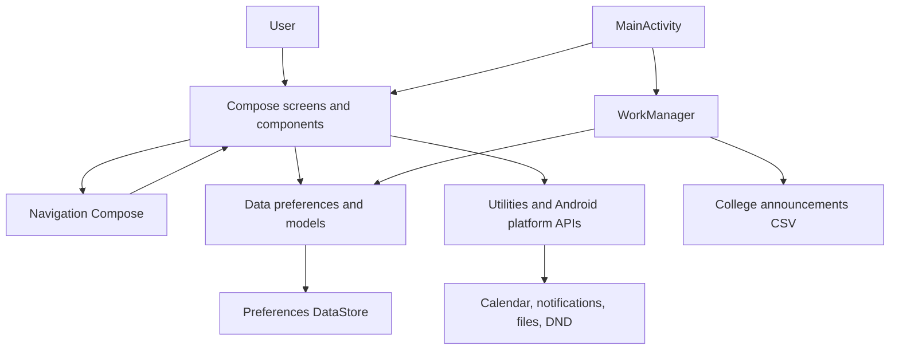

# Classora

Classora is an Android app for keeping college life organized. It brings together academic tracking, attendance, schedules, tasks, reminders, and student documents in one place.

## Features

- Track class timetables, attendance, timetable changes, and attendance statistics.
- Manage academic details, semester results, and SGPA/CGPA calculations.
- Plan tasks and deadlines with reminders, and view them in a calendar.
- Sync tasks with the device calendar.
- Store and organize college documents.
- Configure notifications and Do Not Disturb options.
- Receive college information and announcements.

## Install the app

1. Open the [Classora download on Google Drive](https://drive.google.com/file/d/1lzr5IXm4_OChQOXKpU5i5VGi_4aMJHJa/view?usp=sharing).
2. Download the APK to your Android device.
3. Open the downloaded APK. If Android asks, allow your browser or file manager to install unknown apps, then return to the installer and tap **Install**. You can disable that permission after installation.
4. Open **Classora** and follow the onboarding steps.

Only install the APK if you trust the file and its source. Android may ask you to review app permissions when you use features such as notifications, calendar sync, or document attachments.

## Run from source

### Requirements

- Android Studio with Android SDK 37 installed.
- JDK 17 or newer for Gradle.
- Android device or emulator running Android 7.0 (API 24) or newer.

### Build and run

1. Clone or download this repository and open its root directory in Android Studio.
2. Allow Gradle to sync and install any requested Android SDK components.
3. Select an emulator or connected Android device, then run the `app` configuration.

To build a debug APK from Windows PowerShell:

```powershell
.\gradlew.bat assembleDebug
```

The APK is created at `app/build/outputs/apk/debug/app-debug.apk`.

## Architecture

Classora uses a single-module, lightweight layered architecture built around Jetpack Compose. It separates screen presentation and navigation from local data access and Android platform/background integrations. It is not a strict MVVM implementation: most screens collect data and manage screen-level state directly in composables, without a dedicated ViewModel layer.



- **Application entry point:** `MainActivity` applies the app theme and schedules periodic announcement updates.
- **Presentation and navigation:** `ui/screens` contains Compose screens; `ui/components` contains shared UI; `ui/navigation` defines route identifiers. `MainScreen` wires the navigation graph and the main app destinations.
- **Data:** `data` contains models and preference classes. DataStore persists user profile, settings, tasks, attendance/timetables, notifications, and document metadata on the device; structured lists are serialized with Gson.
- **Utilities and platform integrations:** `utils` contains CSV parsing and notification/Do Not Disturb scheduling. Screens and receivers also use Android APIs for calendar access, file sharing, alarms, and notifications.
- **Background work:** `worker/InfoUpdateWorker` periodically fetches college announcement data, and `MainScreen` also checks for announcements while the app is in the foreground. Receivers under `receiver` respond to scheduled notifications, device restart, and silent-mode actions.

Core user data is stored locally. Announcement updates require an internet connection, and calendar, notification, and file features may require Android permissions.

## Project structure

```text
app/src/main/java/com/example/classora/
├── data/        # Models and DataStore-backed preferences
├── receiver/    # Android broadcast receivers
├── ui/
│   ├── components/
│   ├── navigation/
│   ├── screens/
│   └── theme/
├── utils/       # CSV, notification, and DND helpers
├── worker/      # WorkManager jobs
└── MainActivity.kt
```

## Technology

Kotlin, Jetpack Compose and Material 3, Navigation Compose, Preferences DataStore, Gson, WorkManager, and Android platform APIs.
